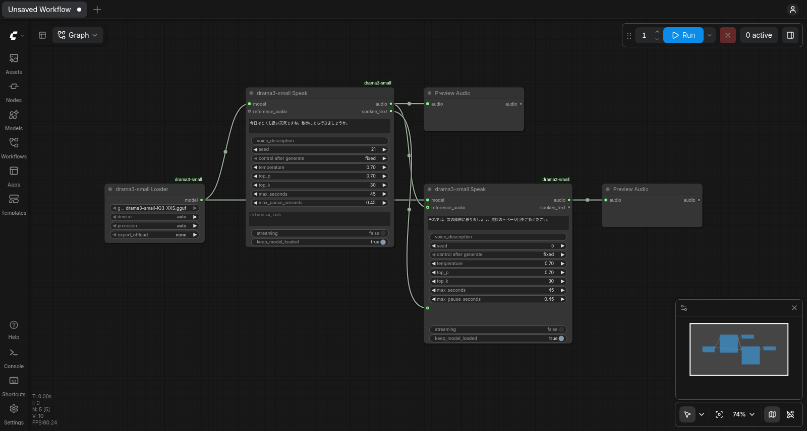

# ComfyUI-drama3-small

**Built with Fish Audio.** Expressive Japanese and English speech in ComfyUI with
[drama3-small](https://huggingface.co/pentacoxian-dev/drama3-small-GGUF), a 9.7 GiB compression of
[Fish Audio Drama 3](https://huggingface.co/fishaudio/drama-3) that fits on 12 GB GPUs.
Fish Audio does not sponsor or endorse this project.

- **Generate new voices:** with no reference audio the model invents a voice. The seed picks it, and an optional English description ("a deep, calm older man's voice") steers it.
- **Keep a voice:** feed a generated clip back in as the reference to reuse that voice for more lines.
- **Clone a voice** from 3–30 s of reference audio and its transcript.
- **Direct the delivery:** inline tags such as `[laughs]` `[sighs]` `[pause]`, spans such as `<whisper>…</whisper>`, English style directions, director's notes.
- **Long text** is split into chunks automatically; each chunk continues from the previous one. VRAM does not grow with length, and the optional `streaming` mode decodes the audio while it is generated.
- **Low VRAM:** `expert_offload` keeps the mixture-of-experts weights in system RAM. The model then runs in about 4.4 GB of VRAM, still faster than real time on an RTX 4090.
- **Pure PyTorch.** No audio.cpp or compiled extensions. The quantized weights stay quantized, and fused Triton kernels dequantize them on the fly.

## Install

```bash
cd ComfyUI/custom_nodes
git clone https://github.com/pentaCoxian/ComfyUI-drama3-small.git
pip install -r ComfyUI-drama3-small/requirements.txt   # usually already satisfied by ComfyUI
```

On first use, the loader downloads `drama3-small-IQ3_XXS.gguf` (9.7 GiB) from
[pentacoxian-dev/drama3-small-GGUF](https://huggingface.co/pentacoxian-dev/drama3-small-GGUF) into
`ComfyUI/models/drama3/`. You can also put the file there yourself.

**Speed depends on Triton.** PyTorch includes Triton on Linux, for both NVIDIA and ROCm builds. On Windows, install it with `pip install triton-windows`. Without Triton, for example on Apple Silicon or the CPU, the engine falls back to plain PyTorch kernels. That works, but it is much slower.

## Nodes

| Node | Inputs | Outputs |
|---|---|---|
| **drama3-small Loader** | `gguf`, `device`, `precision`, `expert_offload` (none / half / all) | `model` |
| **drama3-small Speak** | `model`, `text`, `voice_description`, `seed`, sampling, `max_seconds` (per chunk), `max_pause_seconds`; optional `reference_audio` + `reference_text`, `streaming`, `keep_model_loaded` | `audio` (44.1 kHz mono), `spoken_text` |

## Workflows

Example workflows are in `example_workflows/`. ComfyUI also lists them under *Templates*.



| Workflow | How to wire it |
|---|---|
| **Generate a voice** | Loader → Speak (no reference) → Preview Audio. Change the seed for a different voice, or describe the voice you want. |
| **Keep a generated voice** | Speak A (no reference) → its `audio` and `spoken_text` into Speak B's `reference_audio` and `reference_text`. Set Speak A's seed to *fixed*. The audio carries the exact codes along, so nothing is lost to re-encoding. A kept voice holds best in the language it was made in. |
| **Clone a voice** | Load Audio → Speak's `reference_audio`, and type what the clip says into `reference_text`. Only use voices you have consent to clone. |

## Writing text

| Control | Example |
|---|---|
| Point tags | `[laughs]` `[sighs]` `[gasps]` `[pause]` `[hesitates]` `[clears throat]` `[coughs]` |
| Spans | `<whisper>…</whisper>` `<emphasis>…</emphasis>` |
| Style direction, at the start of the line | `[with heavy, deflated sadness] I kept the light on for you.` |
| Director's note | `Direction: icy calm. Put the rise on "goodbye".` then a new line `Line: So this is goodbye.` |

Directions must be in English; the spoken text can be Japanese, English, or Japanese with English technical terms.

## VRAM, long text and speed

Measured with a 29 s reference clip, four kinds of line, CUDA graphs on, and ComfyUI's default memory allocator. VRAM is the whole process.

| GPU | `expert_offload` | VRAM | Speed (audio seconds per second) | Decoding |
|---|---|---|---|---|
| RTX 4090 | none | 9.6 GB | 2.3× | 62 frames/s |
| RTX 4090 | half | 7.0 GB | 1.7× | 43 frames/s |
| RTX 4090 | all | 4.4 GB | 1.3× | 30 frames/s |
| RTX 5090 | none | 9.7 GB | 2.5× | 68 frames/s |

- **`expert_offload`:** keeps the routed-expert weights (5.2 GB in total) in pinned system RAM. Each frame the GPU reads only the 8 experts it needs, about 10 MB per layer, over PCIe. `half` offloads the biggest layers first. The audio is identical in every mode. Speed depends on the PCIe link; the numbers above are PCIe 4.0 x16.
- **Long text:** each chunk of about 200 characters is generated against the reference and the previous chunk only. The codec decodes through a streaming decoder with a fixed-size cache. VRAM therefore stays flat: a 3-minute take peaked at 9.46 GiB allocated, against 9.29 GiB for short lines.
- **`streaming`:** decodes the audio in 2-second blocks while it is generated and moves each block to system RAM. On long takes it lowers the memory PyTorch reserves by about 1 GB. The audio is the same.
- **Fallback paths, measured on an RTX 4090:** without CUDA graphs, about 1× real time. Without Triton (pure PyTorch kernels), about 0.2× real time.

## How it works

`drama3_torch/` is a self-contained inference engine:
- **GGUF reader:** reads the audio.cpp-format package. Config and tokenizer are embedded in it.
- **Model:** the Drama 3 backbone is 40 hybrid layers (Gated DeltaNet + gated attention, top-8 mixture-of-experts with a shared expert), followed by the audio tower (4 + 9 layers). The quantized weights run through fused Triton kernels: Q8_0 matrix-vector products, and IQ3_XXS experts dequantized only for the 8 experts each token routes to.
- **Codec:** the Fish DAC codec. The decoder streams, with windowed key/value caches and causal context, so VRAM stays flat at any length.
- **Sampling:** the same sampler as audio.cpp's Drama 3 port: top-p/top-k plus Drama 3's repetition-aware redraw.
- **Pause fix (drama3-small's):** after `max_pause_seconds` of silence the silence codes are masked, so the model has to speak or stop, and a length guard ends runaway takes.
  - Silence is recognised by a list of 286 codes that are at least 90% quiet in drama3-small's own renders (`silence_codes.json`, v4).
  - Each take also extends its own list: short runs of other codes sandwiched between silence join it. This stops the model from slipping out of a pause with rare quiet codes.
  - On 48 generated-voice takes, pauses longer than 2 s dropped from 11 to 3.
- **Decoding:** each frame's decode step is captured as a CUDA graph.

Verification against the reference implementations:
- **Teacher-forced proxy:** KL to the original Drama 3 on 152 held-out pairs is 0.0728. The same checkpoint scored 0.0735 in PyTorch training form.
- **Kernels:** the dequantization kernels are bit-exact against ggml's.
- **Codec:** decoding matches fish-speech's codec at 53 dB SNR, streamed or not.
- **Listening-set quality:** on the 58-line showcase, over three seeds each, flagged takes and speaker similarity match the audio.cpp build within seed noise.

## Limitations

- **Voice design was not a training target.** The descriptions steer gender, age, pitch and texture reliably, but they are not precise.
- **Weaknesses inherited from Drama 3:** `[gasps]` at the start of a line, `<slow>` spans, and codes or numbers such as "UA 837". Write those out as words.
- **Tested hardware:** only NVIDIA GPUs on Linux (RTX 5090, RTX 4090). AMD (ROCm), Windows and Apple Silicon should work but are untested.

## License and acceptable use

Licensed under the **Fish Audio Community License v1.0**. See `LICENSE`, and `NOTICE` for attribution and a list of modifications.
- Free for research and non-commercial use. Limited commercial use is allowed below USD 500k annual revenue.
- Offering this as a hosted TTS or voice-cloning service needs a separate license from Fish Audio.

Do not use this model or its output to:
- imitate the voice of an identifiable person without their consent;
- impersonate anyone to deceive, defraud or harass;
- produce sexual content involving minors or non-consenting real people;
- remove watermarks or provenance signals.

If you offer voice cloning built on this to others, you must bind them to restrictions at least as protective as these.
